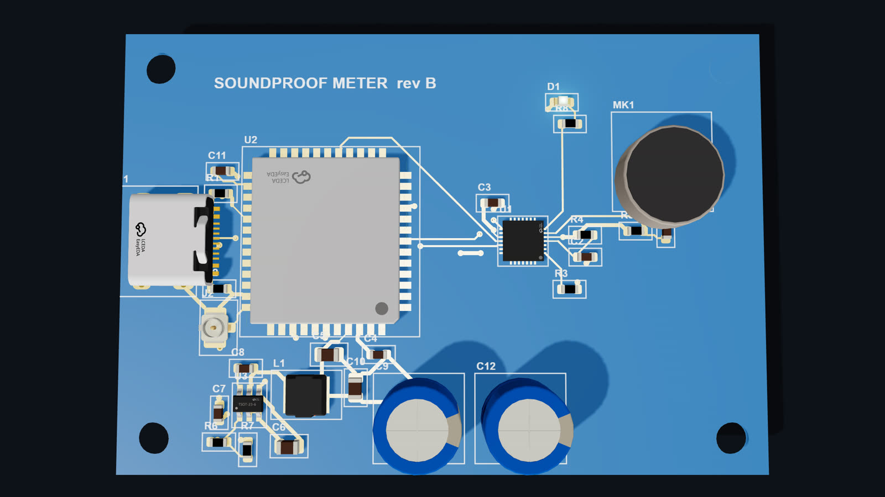
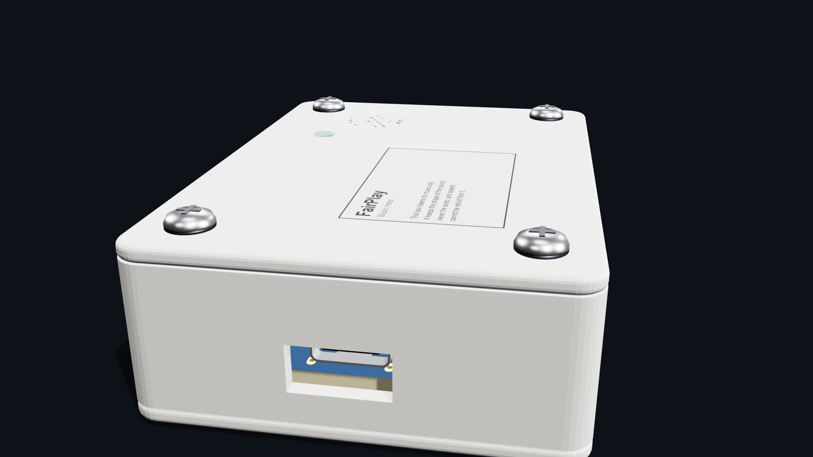

# Fair Play

### *Fair Play. Fair Pay.*

**A small "listening box" in every bar tells SONACAM which Cameroonian songs were really played, so each artist's share of the royalties follows real plays instead of a flat amount for everyone.**

CIMFEST Hackathon 2026 · Track: Creative Economy Infrastructure · Buea, Cameroon

**Try it live:** [blessing.tail754773.ts.net](https://blessing.tail754773.ts.net) · **Code:** [github.com/favour-tamfu/Fair_play](https://github.com/favour-tamfu/Fair_play)

---

## Contents
1. [The problem](#1-the-problem)
2. [Fair Play in one minute](#2-fair-play-in-one-minute)
3. [The real product](#3-the-real-product)
4. [How a song gets counted](#4-how-a-song-gets-counted)
5. [Try it live](#5-try-it-live)
6. [Run it yourself (Windows)](#6-run-it-yourself-windows)
7. [The meter](#7-the-meter)
8. [The SONACAM server](#8-the-sonacam-server)
9. [The web pages](#9-the-web-pages)
10. [Counting fairly](#10-counting-fairly)
11. [Trust: the tamper-proof play log](#11-trust-the-tamper-proof-play-log)
12. [Measured during the hackathon](#12-measured-during-the-hackathon)
13. [Limits](#13-limits)
14. [Declarations](#14-declarations)

---

## 1. The problem

SONACAM, Cameroon's music copyright society, collects licence fees from bars, hotels and other venues that play music. What it cannot see is *which songs* those venues play. Its own website says that missing information on how works are used prevents fair distributions, and that SONACAM must prove it pays according to real use ([sonacam.org](https://www.sonacam.org/)). Its board president said in 2023 that it was hard to tell precisely which artists deserved more ([Cameroon Tribune](https://www.cameroon-tribune.cm/article.html/58312/fr.html/droits-dauteur-dans-lart-musical-notes-despoir)). In October 2025 SONACAM announced the same flat advance of 27,000 FCFA for every artist ([SCN](https://sportsandculturenetwork.com/droits-dauteur-seulement-27-000-fcfa-par-artiste/)): the hit that fills every bar and the song nobody played were paid alike.

The missing piece is a record of what venues really play: cheap enough for every bar, private enough that nobody's conversation is recorded, and trustworthy enough that artists can believe it. That is what Fair Play builds.

---

## 2. Fair Play in one minute

| Today | With Fair Play |
|---|---|
| SONACAM collects money from bars but cannot see what was played, so it pays every artist the same flat advance. | A meter in each bar recognises the songs it hears (like a music-recognition app) and reports them. |
| Popular artists are underpaid, and nobody can check the split. | Each artist's share follows how much their songs were really played. |
| Records can be changed quietly. | Every play is written into a tamper-proof log; any change is detected in about a second. |

**Privacy:** the meter never records or sends sound. It sends only a "fingerprint" of the music (a list of the loudest notes over time), which cannot be turned back into audio or speech.

---

## 3. The real product

In real bars, Fair Play has four pieces:

| Piece | In the real world | Who uses it |
|---|---|---|
| **The meter** | A small sealed box on the bar wall, about the size of a phone charger: a low-cost chip (CH32V203 RISC-V microcontroller), a small microphone and a 4G modem, about $5–8 in parts. It plugs into the mains and needs no Wi-Fi from the bar. | Installed by SONACAM in every bar it licenses |
| **The SONACAM server** | SONACAM's computer system (in a data centre or the cloud). It receives the meters' reports, recognises the songs, keeps the tamper-proof log and computes each artist's share. | SONACAM |
| **The SONACAM app** | Web pages for SONACAM: songs heard live, meters on a map, each artist's share and analytics, the whole catalogue, the log's integrity, and operations (meters waiting for approval, the activity log, items to review). | SONACAM |
| **The artist portal** | Web pages that work on a phone: artists or labels upload their songs with their owners and shares, and follow their own songs: when they were played, how many plays counted, their share and how it was computed. | Artists, labels |

### The meter box (3D model)
The meter is designed as a small sealed box: a two-layer circuit board (64 × 44 mm) with the microphone, the main module and its antenna lead, the power supply, a USB-C power input and a status light, in a four-screw case. The label on the lid tells people in the bar that it listens for music only and keeps no sound.

<p align="center"> </p>
<p align="center"> </p>

<p align="center"></p>

Full-quality video: [meter-assembly.mp4](web/assets/meter/meter-assembly.mp4) (20 s) · More views: [exploded side](web/assets/meter/04-exploded-side.jpg), [board underside wiring](web/assets/meter/06-underside-wiring.jpg), [power trace](web/assets/meter/07-net-3v8-highlight.jpg). The renders still carry the project's earlier working name on the board and lid labels.

### During the hackathon
We could not get the electronics in time, so for the hackathon and the demo two laptops play the roles:
- **Laptop A plays the meter.** It runs exactly the computation the box would run, packed as one program, `FairPlayMeter.exe` (see [The meter](#7-the-meter)).
- **Laptop B plays SONACAM's server.** It runs the server in Docker and is online at a fixed secure public address, so meters, SONACAM and artists reach it from anywhere, phones included.
- Any internet connection stands in for 4G.

---

## 4. How a song gets counted

```
 IN THE BAR (the meter; Laptop A in the demo)  AT SONACAM (the server; Laptop B in the demo)     ON SCREEN
 ┌──────────────────────────────┐ 4G / net  ┌─────────────────────────────────────────┐   ┌──────────────────────┐
 │ microphone                   │  signed   │ 1. check the meter's signature          │   │ SONACAM dashboard    │
 │  → every 10 s: fingerprint   │ ────────► │ 2. match the fingerprint to a song      │──►│  live feed, map,     │
 │  → sign it (meter's own key) │  reports  │ 3. join matches into plays              │   │  songs, artists'     │
 │  → keep it until SONACAM     │           │ 4. write plays to the tamper-proof log  │   │  shares              │
 │    confirms it was stored    │           │ 5. count them fairly → shares           │   │ Artist portal (phone)│
 └──────────────────────────────┘           └─────────────────────────────────────────┘   └──────────────────────┘
```

Follow one song through the system. An artist uploads it on the artist portal, and the server learns its fingerprint once, in about a minute. That evening a bar in Douala plays it. The meter on the wall hears ten seconds of it, turns those ten seconds into a fingerprint, seals the report with its own key and sends it. At SONACAM, the server checks the seal, finds the song in the catalogue, and joins consecutive matches into one play ("this song, at this bar, from 21:03 to 21:07"). The play is written into the tamper-proof log, and within seconds it appears on SONACAM's dashboard; within 15 seconds the artist's share has moved.

If the bar's connection drops, nothing is lost: the meter keeps every report until the server confirms it, then sends the backlog in order. New meters cannot simply start sending, either: each one asks to join and waits until SONACAM approves its key.

Detailed design: [`docs/00_PROJECT_BRIEF.md`](docs/00_PROJECT_BRIEF.md). Exact message formats: [`docs/01_CONTRACT.md`](docs/01_CONTRACT.md).

---

## 5. Try it live

The live system runs on Laptop B and is reachable from any browser or phone while that laptop is on:

| Page | Link | Who |
|---|---|---|
| Public page | [blessing.tail754773.ts.net](https://blessing.tail754773.ts.net) | Everyone |
| Sign in | [blessing.tail754773.ts.net/login.html](https://blessing.tail754773.ts.net/login.html) | SONACAM and artists |
| SONACAM dashboard | [blessing.tail754773.ts.net/sonacam-x7k2q9.html](https://blessing.tail754773.ts.net/sonacam-x7k2q9.html) | SONACAM (sign-in) |
| SONACAM operations | [blessing.tail754773.ts.net/sonacam-x7k2q9-admin.html](https://blessing.tail754773.ts.net/sonacam-x7k2q9-admin.html) | SONACAM (sign-in) |
| One artist's analytics | [blessing.tail754773.ts.net/sonacam-x7k2q9-artist.html?name=Locko](https://blessing.tail754773.ts.net/sonacam-x7k2q9-artist.html?name=Locko) | SONACAM (sign-in) |
| Artist portal | [blessing.tail754773.ts.net/portal.html](https://blessing.tail754773.ts.net/portal.html) | An artist (sign-in) |
| Server health | [blessing.tail754773.ts.net/health](https://blessing.tail754773.ts.net/health) | Everyone |

There are two roles. **SONACAM** sees everything; **an artist** sees only their own songs. Sign-in details for the judges are given with the submission. Two periods can be viewed: **Live** (what the meters hear now) and a **mock month**, a simulated month of 31 bars playing the real 183-song catalogue, used to show what a month of data looks like.

---

## 6. Run it yourself (Windows)

Fair Play is **one system in three parts**: the **SONACAM server** (one computer with Docker), a **meter** in each bar (during the hackathon, a laptop running `FairPlayMeter.exe`), and the **web pages**, served by the server.

**You need:** Windows 10/11 and [Docker Desktop](https://www.docker.com/products/docker-desktop/) running. Git and Python 3.11 are only needed to develop or run the tests.

### Install and start the server: one command
```powershell
git clone https://github.com/favour-tamfu/Fair_play.git
cd Fair_play
powershell -ExecutionPolicy Bypass -File .\scripts\install_server.ps1 -SongPackage C:\path\to\Fair_Play_song_package
```
The installer checks Docker, creates `.env` with new random passwords (the SONACAM password is `ADMIN_TOKEN` in `.env`; it is never printed), builds and starts every part, imports and fingerprints the songs (a song package is a folder with `catalogue.csv` and `audio/`; the audio is not in git), runs a readiness check and prints the addresses. Running it again is safe: it keeps `.env` and the data. Then open [http://localhost:8000](http://localhost:8000) on that computer.

### Put it online
Install [Tailscale](https://tailscale.com/download) on the server computer, sign in, then run `tailscale funnel --bg 8000`. The server is then reachable at a fixed secure address (`https://<computer name>.<tailnet>.ts.net`) from any network and any phone, with no router changes. This is how the live demo above is served.

### Install a meter
Build the meter with the server's address inside (`.\device\packaging\build.ps1 -Url https://<server address>`), copy `FairPlayMeter.exe` to the bar laptop and double-click it. It asks no questions: it makes its own key, shows a key fingerprint and **asks SONACAM to join**. On the operations page (Meters › Waiting for approval), SONACAM checks the fingerprint matches the one on the meter's screen and approves it; the meter then starts listening by itself. Details: [`device/packaging/README.md`](device/packaging/README.md).

### Stop
`docker compose stop` keeps all data; `docker compose start` starts again.

---

## 7. The meter

### How the real device works
The real meter is a small box built around a CH32V203 RISC-V microcontroller, an electret microphone and a 4G Cat-1 modem, about $5–8 in parts. In a bar it works on its own, all day:

1. **Listens in short bursts:** 10 seconds of sound every minute.
2. **Makes a fingerprint, not a recording.** It reduces the sound to 8,000 samples a second, finds the loudest notes and when they happen, and pairs them into short codes. A song always leaves the same pattern; the music, and anyone's voice, cannot be rebuilt from it.
3. **Seals the report** with its own secret key (an Ed25519 signature), so nobody can fake or change it on the way.
4. **Sends it over 4G** (a few kilobytes). If the network is down, reports wait in the box's memory and are sent later, in order.
5. **Reports which phone tower it is near**, which the 4G modem knows for free, so a meter moved to another place is noticed.
6. **Sends a regular heartbeat**: it is online, how many reports are waiting, and a clock check so play times stay right.

### How the laptop mimics it for the demo
Without the electronics, Laptop A runs **exactly the computation the box would run, and no more**, in the meter program `FairPlayMeter.exe`:

| Real device | Laptop during the hackathon |
|---|---|
| Electret microphone | The laptop's microphone, reduced to the same 8,000 samples a second |
| Fingerprint on the chip | The same fingerprint code (shared with the server in `core/`), byte for byte |
| Secret key in the chip | A key made on the laptop the first time the meter starts, kept in the meter's own folder |
| 4G modem | The laptop's internet connection, to SONACAM's public address |
| Phone-tower id from the modem | A tower id written in the meter's settings |
| 10 seconds every minute | 10 seconds every 10 seconds in demo mode, so plays show up fast (`--mode field` gives the real rhythm) |

The meter program is one file: double-click it, and it sets itself up, asks SONACAM to join and, once approved, listens in the background behind a small menu (status, pause, check the connection, meter details, stop). A meter that SONACAM rejects or retires stops by itself.

**Virtual meters** let one laptop stand in for many bars: the same pipeline is fed audio files instead of a microphone, optionally mixed with recorded crowd noise, in real time or a whole evening replayed in minutes (`python -m device.virtual`). Every meter, real or virtual, goes through exactly the same checks on the server.

**Tested:** recordings made on a phone in a room were recognised (music windows matched with scores of 16 to 89, where 8 is enough; silent windows were rejected), and the packaged meter running against the live server matched 6 of 6 windows of a song played near it.

---

## 8. The SONACAM server

The server is six small programs (Docker containers) that share one database:

| Part | Its job, in plain words |
|---|---|
| `db` | The database (PostgreSQL): songs, fingerprints, plays, the log, results. |
| `api` | The front door: receives meter reports, join requests and song uploads, signs people in, answers the web pages, streams the live feed. |
| `worker_fp` | Learns each uploaded song: makes its fingerprint and checks it is not a copy of a song already in the catalogue. |
| `worker_match` | Recognises songs: compares each 10-second fingerprint from a meter with the catalogue. |
| `worker_play` | Turns recognised moments into plays ("song X played at bar Y from 21:03 to 21:07") and writes them to the log. |
| `scheduler` | Housekeeping: re-checks the log every second, publishes an hourly checkpoint, refreshes the results within 15 s of a new play, watches which meters are online, keeps the activity log for 14 days. |

Every report is checked before it is used: a report from an unknown, unapproved or retired meter, or with a broken seal, is refused and written to the activity log. SONACAM actions (approving or retiring a meter, recomputing results) need a SONACAM sign-in, and every sign-in and admin action is logged too. Times shown to people are Cameroon time; stored data uses UTC. The exact formats of every message are in [`docs/01_CONTRACT.md`](docs/01_CONTRACT.md).

---

## 9. The web pages

All pages are plain HTML, CSS and JavaScript served by the SONACAM server, so they load fast on a weak connection and work on a phone. Live updates arrive through a stream from the server: a song heard by a meter appears on screen within seconds, without reloading.

- **[Public page](https://blessing.tail754773.ts.net):** the story for everyone: the problem, the meter (3D renders and video), live and monthly totals, recent plays by city, and how the counting stays honest. It shows totals only, never one artist's detail.
- **[Sign in](https://blessing.tail754773.ts.net/login.html):** one page for everyone; it opens the SONACAM app or the artist's portal depending on who signs in.
- **[SONACAM dashboard](https://blessing.tail754773.ts.net/sonacam-x7k2q9.html):** one app with a sidebar. *Overview* puts what matters first: the key figures, then live activity ("Hearing now") beside a street map of the metered bars, then plays by artist as a ranked bar chart and *Who earned what* with each artist's share. *Songs* lists the whole catalogue, played or not. *Trust* shows the state of the tamper-proof log.
- **[SONACAM operations](https://blessing.tail754773.ts.net/sonacam-x7k2q9-admin.html):** meters (online, last seen, key fingerprint, retire), new meters waiting for approval, the activity log (every report, refusal, sign-in and admin action, searchable and exportable), items to review and the catalogue.
- **[Artist analytics](https://blessing.tail754773.ts.net/sonacam-x7k2q9-artist.html?name=Locko):** one artist's songs, plays by day and the bars that played them, for SONACAM only.
- **[Artist portal](https://blessing.tail754773.ts.net/portal.html):** on a phone, an artist sees their own songs only: their share, when their songs were played, plays counted and, step by step, how their share was computed. They upload new songs here, with their owners and shares.

Maps use OpenStreetMap; without internet, the pages fall back to our own drawn outline of Cameroon.

---

## 10. Counting fairly

Fair Play counts every play it hears, and keeps the raw count. On top of it, an optional set of **fair-play rules** (version `sr-1.0`) makes repeats of the same song in the same bar count a little less (1, 1, ½, ¼, then nothing for two hours), so looping one song cannot buy a bigger share. Unusual patterns, such as a song looped back to back or plays in an empty room at 4 am, are marked for SONACAM to look at.

The rules are a choice, not a filter: every raw play is preserved, so SONACAM can switch between **Raw** (every play counts 1) and **Standardised** (with the rules) at any time on the dashboard, and the shares are recomputed from the same plays.

Shares are simple: a **song's share** is its counted plays divided by all counted plays in the period, and an **artist's share** is the shares of all their songs added up. In this prototype each artist is registered as the 100 % owner of their songs, and the result stops at each artist's share: no money is calculated.

---

## 11. Trust: the tamper-proof play log

- Every play is chained to the one before it with a cryptographic hash, like numbered, sealed pages in a notebook. Changing any recorded play breaks the chain from that point.
- The server re-checks the whole chain every second. **Measured: an edited play shows as "log broken" on the dashboard 0.9 seconds later**, and results are withheld until the log is restored.
- Every hour a checkpoint of the log (a Merkle root: one short code that summarises all plays of that hour) is written to an append-only anchors file. In a real deployment it would go somewhere SONACAM does not control, such as a public blockchain, so even SONACAM could not quietly rewrite the past.
- A reset of the demo data does not erase history silently: it starts a new "epoch" and writes the reset itself into the anchors file.

---

## 12. Measured during the hackathon

| What | Result |
|---|---|
| Restart test: every server part restarted while a meter was sending | 36 of 36 reports stored exactly once, 3 of 3 plays correct, log intact |
| Live meter through a 20-minute server outage | 2,501 reports in a row, none missing, none duplicated |
| Song recognition time per 10-second window (66 songs in the catalogue) | median 13 ms, 95 % under 49 ms |
| Recognition of the 183-song catalogue (3 clips per song, clean audio) | 549 of 549 correct |
| Packaged meter against the live server, a song played near it | 6 of 6 windows matched |
| Tamper alarm (edit a play → dashboard shows "log broken") | 0.9 s (restore → "intact" in 1.1 s) |
| Mock month (30 days, 31 bars, 183 songs by 61 artists, 71,957 plays): import and results | about 15 seconds |

All numbers were measured on the two hackathon laptops.

---

## 13. Limits

- **No meter box yet.** For the hackathon and the demo, laptops stand in for the meter and for SONACAM's server because the electronics could not be obtained in time; any internet connection stands in for 4G.
- **The server is a laptop.** The live address works only while Laptop B is on, with Docker and Tailscale running. SONACAM would run the same server on its own machines.
- **The mock month is simulated.** Bars, plays and listening patterns are generated (seeded, repeatable); only the songs are real. It is never presented as real results.
- **No money moves.** Results end at each artist's share; owners are set to the artist (100 %) until real splits are registered.
- **One credited artist per song.** Featured artists are not yet given their own share.
- **Recognition needs the song in the catalogue.** Music that was never uploaded is not counted and not recorded.
- **Catch rates are 80 % until a meter is calibrated** on site with known songs.
- **Prototype keys and passwords.** Meter keys are made on the laptop, and all artists share one prototype password; a real deployment would provision keys in the box and give each artist their own password.

---

## 14. Declarations

All code in this repository was written during the hackathon (Monday 23 to Wednesday 25 November 2026). **Claude Code (Anthropic) was used as an AI coding assistant.**

### Libraries and tools
| Library / tool | Version | Licence | Used for | Side |
|---|---|---|---|---|
| Python | 3.11 | PSF | everything | A, B |
| numpy | 2.1.3 | BSD-3-Clause | arrays, signal maths | A, B |
| scipy | 1.14.1 | BSD-3-Clause | spectrogram, filters, resampling | A, B |
| PyNaCl | 1.5.0 | Apache-2.0 | Ed25519 signatures (meter seals) | A, B |
| pydantic | 2.9.2 | MIT | checking message formats | A, B |
| httpx | 0.27.2 | BSD-3-Clause | sending reports, test client | A, B |
| FastAPI | 0.115.5 | MIT | server API | A, B |
| Uvicorn | 0.32.1 | BSD-3-Clause | web server | A, B |
| jsonschema | 4.23.0 | MIT | contract checks in tests | A, B |
| pytest | 8.3.3 | MIT | tests | A, B |
| psycopg | 3.2.3 | LGPL-3.0 | PostgreSQL driver | B |
| python-multipart | 0.0.17 | Apache-2.0 | song upload forms | B |
| pandas | 2.2.3 | BSD-3-Clause | results tables | B |
| sse-starlette | 2.1.3 | BSD-3-Clause | live feed | B |
| sounddevice | 0.5.1 | MIT | microphone capture | A |
| soundfile | 0.12.1 | BSD-3-Clause | reading WAV files | A |
| rich | 13.9.4 | MIT | meter status screen | A |
| tomli-w | 1.1.0 | MIT | meter config files | A |
| PyInstaller | 6.11.1 | GPL-2.0 with bootloader exception | packing the meter as one `FairPlayMeter.exe` | A |
| PostgreSQL | 16 (Docker image) | PostgreSQL Licence | database, fingerprint index, job queue | B |
| FFmpeg | Debian package in the server image | LGPL/GPL | decoding uploaded songs | B |
| Docker Desktop | — | Docker subscription terms | running the server | B |
| Leaflet | 1.9.4 (in `web/vendor/leaflet`, checked against the published integrity hashes) | BSD-2-Clause | street maps on the web pages | B |
| Tailscale (Funnel) | Windows client | Tailscale terms | the server's public https address | B |
| fontTools, brotli | 4.55.3, 1.1.0 | MIT | making small web copies of the fonts (not shipped) | B |

### Data and assets
| What | Source |
|---|---|
| Song catalogue | 183 songs by 61 Cameroonian artists, compiled by the team for testing the prototype. Audio files are not in this repository. |
| Mock month | Generated by our code (`server/tools/catalogue_month.py`, seeded); bars, venue sizes and coordinates are illustrative. The repeated-song, promotion and empty-room scenarios use three fictional test tracks by "Fair Play test artist", so no real artist is shown gaming the system. |
| Album covers | Looked up through the public iTunes Search API (`tools/covers/`) and stored in `web/assets/covers/`. They belong to their artists and labels and are shown only next to those artists' own songs. |
| Photos | Pexels and Unsplash photos under their licences (credits in the public page footer). |
| Map tiles | OpenStreetMap standard tiles (© OpenStreetMap contributors, ODbL; credited on each map). Without internet the pages show our drawn outline map; add `?map=outline` to a page address to force it. |
| Fonts | SF Pro (Apple) is not in this repository, as Apple's licence does not allow redistributing it. To show it, put the `.woff2` files in `web/fonts/` (`web/css/fonts.css` lists the 10 names). Without them the pages use the system font. |
| Background on SONACAM | [sonacam.org](https://www.sonacam.org/), [Cameroon Tribune (2023)](https://www.cameroon-tribune.cm/article.html/58312/fr.html/droits-dauteur-dans-lart-musical-notes-despoir), [Sports and Culture Network (2025)](https://sportsandculturenetwork.com/droits-dauteur-seulement-27-000-fcfa-par-artiste/) |
| Test signals | Synthetic tones made by our code (`core/tests/data`). |
