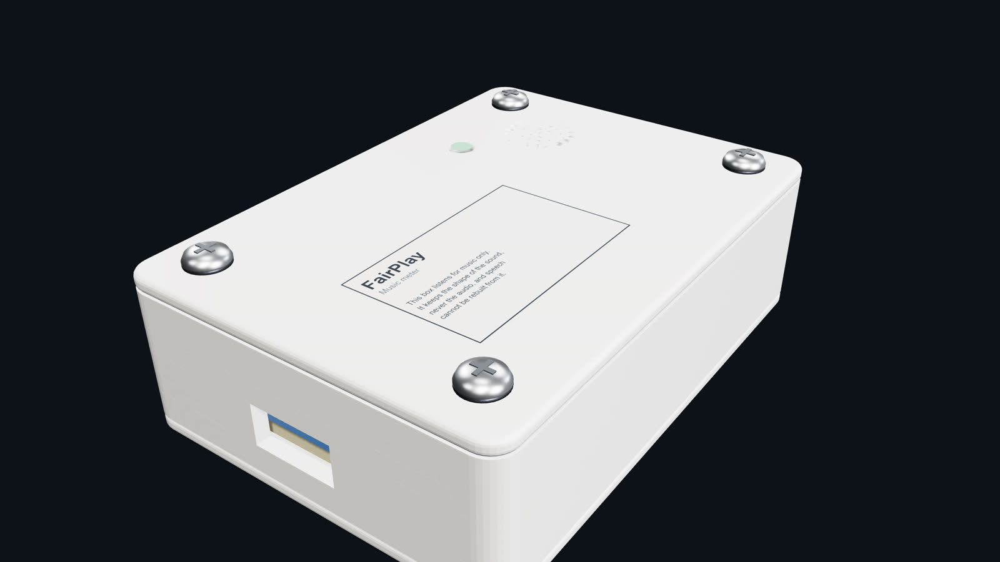
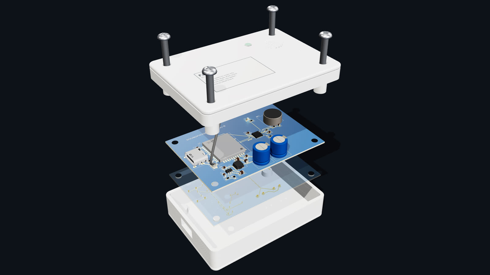
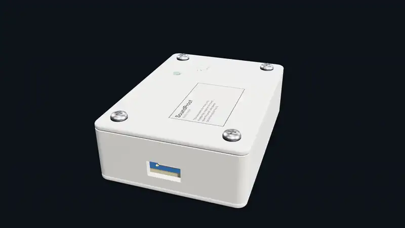

# Fair Play

### *Fair Play. Fair Pay.*

**A small meter in every bar tells SONACAM which songs were really played, so each artist's royalties follow real plays instead of a flat amount for everyone.**

CIMFEST Hackathon 2026 · Track: Creative Economy Infrastructure · Buea, Cameroon

**Live demo:** [blessing.tail754773.ts.net](https://blessing.tail754773.ts.net) · **Code:** [github.com/favour-tamfu/Fair_play](https://github.com/favour-tamfu/Fair_play)

---

## Contents
1. [The problem](#1-the-problem)
2. [The solution](#2-the-solution)
3. [Try it live](#3-try-it-live)
4. [How it works](#4-how-it-works)
5. [The meter](#5-the-meter)
6. [The SONACAM server](#6-the-sonacam-server)
7. [The web pages](#7-the-web-pages)
8. [Counting fairly](#8-counting-fairly)
9. [Trust: the tamper-proof play log](#9-trust-the-tamper-proof-play-log)
10. [Measured](#10-measured)
11. [Run it yourself](#11-run-it-yourself)
12. [Limits](#12-limits)
13. [Declarations](#13-declarations)

---

## 1. The problem

SONACAM, Cameroon's music copyright society, collects licence fees from bars and other venues but cannot see which songs they play. Its own website says missing information on how works are used prevents fair distributions ([sonacam.org](https://www.sonacam.org/)); its board president said it was hard to tell which artists deserved more ([Cameroon Tribune, 2023](https://www.cameroon-tribune.cm/article.html/58312/fr.html/droits-dauteur-dans-lart-musical-notes-despoir)). In October 2025 every artist was announced the same flat advance of 27,000 FCFA ([SCN, 2025](https://sportsandculturenetwork.com/droits-dauteur-seulement-27-000-fcfa-par-artiste/)), whether their songs filled the bars or were never played.

## 2. The solution

| Today | With Fair Play |
|---|---|
| SONACAM cannot see what bars play, so every artist gets the same amount. | A meter in each bar recognises the songs it hears and reports them. |
| Nobody can check the split. | Each artist's share follows their real plays; artists see their own. |
| Records can be changed quietly. | Every play is sealed in a tamper-proof log; a change is caught in under a second. |

**Privacy:** the meter never records sound. It sends only a fingerprint of the music (its loudest notes over time), from which no audio or speech can be rebuilt.

The real product has four parts: **the meter** (a sealed box on the bar wall, about $5–8 in parts, with its own 4G), **the SONACAM server**, **the SONACAM app** (dashboard and operations) and **the artist portal** (phone-friendly).

<p align="center"> </p>
<p align="center"></p>

3D model: [assembly video](web/assets/meter/meter-assembly.mp4) · [board top](web/assets/meter/05-board-top.jpg) · [USB-C side](web/assets/meter/02-usb-c-side.jpg) · [underside wiring](web/assets/meter/06-underside-wiring.jpg). The renders carry the project's earlier working name.

**During the hackathon** the electronics could not be obtained, so two laptops stand in: **Laptop A is the meter** (running the exact computation the box would run) and **Laptop B is SONACAM's server**, online at the live address above.

---

## 3. Try it live

| Page | Link | Access |
|---|---|---|
| Public page | [blessing.tail754773.ts.net](https://blessing.tail754773.ts.net) | Everyone |
| Sign in | [/login.html](https://blessing.tail754773.ts.net/login.html) | SONACAM or an artist |
| SONACAM dashboard | [/sonacam-x7k2q9.html](https://blessing.tail754773.ts.net/sonacam-x7k2q9.html) | SONACAM |
| SONACAM operations | [/sonacam-x7k2q9-admin.html](https://blessing.tail754773.ts.net/sonacam-x7k2q9-admin.html) | SONACAM |
| One artist's analytics | [/sonacam-x7k2q9-artist.html?name=Locko](https://blessing.tail754773.ts.net/sonacam-x7k2q9-artist.html?name=Locko) | SONACAM |
| Artist portal | [/portal.html](https://blessing.tail754773.ts.net/portal.html) | An artist |

**Sign in** at [/login.html](https://blessing.tail754773.ts.net/login.html):

| Role | Username | Password | Sees |
|---|---|---|---|
| SONACAM | `SONACAM` | `4QoHOrA_eOdfPsuR9yJil1Q9OdBiNYCL` | Everything: dashboard and operations |
| Artist | Any artist name from the public page, e.g. `KOCEE` | `SONACAM` (same for every artist) | Only their own songs |

The live site runs while Laptop B is on. Use the **Live / Mock month** switch in the dashboard sidebar: *Live* is what the meters hear now; the *mock month* is a simulated month of 31 bars playing the real 183-song catalogue.

---

## 4. How it works

```
 IN THE BAR (meter)                         AT SONACAM (server)                            ON SCREEN
 ┌──────────────────────────────┐ 4G / net  ┌─────────────────────────────────────────┐   ┌──────────────────────┐
 │ microphone                   │  signed   │ 1. check the meter's signature          │   │ SONACAM dashboard    │
 │  → every 10 s: fingerprint   │ ────────► │ 2. match the fingerprint to a song      │──►│  live feed, map,     │
 │  → sign it (meter's own key) │  reports  │ 3. join matches into plays              │   │  songs, shares       │
 │  → keep it until SONACAM     │           │ 4. write plays to the tamper-proof log  │   │ Artist portal (phone)│
 │    confirms it was stored    │           │ 5. count them → each artist's share     │   │                      │
 └──────────────────────────────┘           └─────────────────────────────────────────┘   └──────────────────────┘
```

An artist uploads a song; the server learns its fingerprint once. When a bar plays it, the meter fingerprints 10 seconds, seals the report and sends it. The server recognises the song, records the play, and the dashboard shows it within seconds; shares update within 15 seconds. If the network drops, the meter keeps its reports and sends them later. A new meter only counts after SONACAM approves it.

Design: [`docs/00_PROJECT_BRIEF.md`](docs/00_PROJECT_BRIEF.md) · Message formats: [`docs/01_CONTRACT.md`](docs/01_CONTRACT.md)

---

## 5. The meter

**The real device** is a CH32V203 RISC-V microcontroller, an electret microphone and a 4G Cat-1 modem. It:
1. listens for 10 seconds every minute;
2. turns the sound into a fingerprint (the loudest notes and their timing, at 8,000 samples a second);
3. seals each report with its own key (Ed25519 signature);
4. sends it over 4G, keeping reports in memory while offline;
5. reports its phone tower, so a moved meter is noticed, and sends a heartbeat with a clock check.

**For the demo, a laptop mimics it** with `FairPlayMeter.exe`, one Windows file:

| Real device | Laptop in the demo |
|---|---|
| Electret microphone | The laptop's microphone, reduced to 8,000 samples a second |
| Fingerprint on the chip | The same fingerprint code the server uses (`core/`) |
| Key stored in the chip | A key made on the laptop at first start |
| 4G modem | The laptop's internet connection |
| Phone-tower id | A tower id in the meter's settings |
| 10 s every minute | 10 s every 10 s, so plays show up fast (`--mode field` for the real rhythm) |

Double-click the exe: it sets itself up, shows a key fingerprint and asks SONACAM to join; once approved on the operations page it listens in the background. **Virtual meters** (`python -m device.virtual`) feed the same pipeline with audio files, optionally mixed with crowd noise, to simulate many bars. Details: [`device/packaging/README.md`](device/packaging/README.md).

---

## 6. The SONACAM server

Six Docker containers sharing one PostgreSQL database:

| Part | Job |
|---|---|
| `db` | Songs, fingerprints, plays, the log, results |
| `api` | Receives meter reports and song uploads, signs people in, serves the pages and the live feed |
| `worker_fp` | Learns each uploaded song's fingerprint; spots copies of existing songs |
| `worker_match` | Recognises each 10-second fingerprint from a meter |
| `worker_play` | Joins matches into plays and writes them to the log |
| `scheduler` | Checks the log every second, hourly checkpoints, refreshes shares within 15 s, tracks meters online |

Reports from unknown, unapproved or retired meters, or with a broken seal, are refused. Every refusal, sign-in and SONACAM action goes into the activity log. People see Cameroon time; data is stored in UTC.

---

## 7. The web pages

Plain HTML, CSS and JavaScript served by the server; live updates arrive by a server stream, no reload needed.

- **[Public page](https://blessing.tail754773.ts.net):** the problem, the meter, live and monthly totals, recent plays by city.
- **[SONACAM dashboard](https://blessing.tail754773.ts.net/sonacam-x7k2q9.html):** key figures, live activity ("Hearing now") beside a map of the metered bars, plays by artist, each artist's share; the full song catalogue; the log's status.
- **[SONACAM operations](https://blessing.tail754773.ts.net/sonacam-x7k2q9-admin.html):** meters (approve, retire), the activity log (searchable, CSV export), items to review, the catalogue.
- **[Artist analytics](https://blessing.tail754773.ts.net/sonacam-x7k2q9-artist.html?name=Locko):** one artist's plays by day and the bars that played them (SONACAM only).
- **[Artist portal](https://blessing.tail754773.ts.net/portal.html):** an artist's own songs, when they were played, their share and how it was computed; song upload with owners and shares.

Maps use OpenStreetMap, with a drawn outline of Cameroon when offline.

---

## 8. Counting fairly

Every play is counted and kept. Optional **fair-play rules** (`sr-1.0`) make repeats of the same song in the same bar count less (1, 1, ½, ¼, then nothing for two hours), so looping a song cannot buy a bigger share; unusual patterns are marked for SONACAM to look at. Because raw plays are preserved, the dashboard switches between **Raw** and **Standardised** at any time.

A **song's share** = its counted plays ÷ all counted plays. An **artist's share** = the sum of their songs' shares. Each artist is the 100 % owner of their songs in this prototype; no money is calculated.

---

## 9. Trust: the tamper-proof play log

Each play is chained to the previous one with a SHA-256 hash, so changing any play breaks the chain. The server re-checks the chain every second; an edited play shows "log broken" on the dashboard in 0.9 s and results are withheld until it is restored. Every hour a Merkle root (one code summarising that hour's plays) is written to an append-only anchors file; in production it would be published somewhere SONACAM does not control.

---

## 10. Measured

| What | Result |
|---|---|
| Every server part restarted while a meter was sending | 36 of 36 reports stored exactly once, log intact |
| Live meter through a 20-minute server outage | 2,501 reports in a row, none lost or duplicated |
| Recognition time per 10-second window | median 13 ms, 95 % under 49 ms |
| 183-song catalogue, 3 clean clips per song | 549 of 549 recognised |
| Packaged meter against the live server | 6 of 6 windows matched |
| Edit a play → "log broken" on the dashboard | 0.9 s (restored → "intact" in 1.1 s) |

---

## 11. Run it yourself

Needs Windows 10/11 and [Docker Desktop](https://www.docker.com/products/docker-desktop/).

```powershell
git clone https://github.com/favour-tamfu/Fair_play.git
cd Fair_play
powershell -ExecutionPolicy Bypass -File .\scripts\install_server.ps1 -SongPackage C:\path\to\Fair_Play_song_package
```
The installer creates `.env` with random passwords (SONACAM's is `ADMIN_TOKEN`), starts every part, imports the songs (a folder with `catalogue.csv` and `audio/`) and checks everything. Open [http://localhost:8000](http://localhost:8000).

- **Online:** install [Tailscale](https://tailscale.com/download) and run `tailscale funnel --bg 8000`.
- **A meter:** `.\device\packaging\build.ps1 -Url https://<server address>`, copy `dist\FairPlayMeter.exe` to the bar laptop, double-click, approve it under Operations › Meters.
- **Stop / start:** `docker compose stop` / `docker compose start` (data is kept).

---

## 12. Limits

- **No meter box yet:** laptops stand in for the meter and the server during the hackathon.
- **The live server is a laptop:** it is online only while Laptop B runs.
- **The mock month is simulated:** generated bars and plays over the real songs, for testing only.
- **No money moves:** results stop at each artist's share; one credited artist per song.
- **Only catalogue songs are recognised;** catch rates are 80 % until a meter is calibrated.
- **Prototype credentials:** meter keys are made on the laptop and all artists share one password.

---

## 13. Declarations

All code was written during the hackathon (23–25 November 2026). **Claude Code (Anthropic) was used as an AI coding assistant.**

| Library / tool | Version | Licence | Used for |
|---|---|---|---|
| Python | 3.11 | PSF | everything |
| numpy, scipy | 2.1.3, 1.14.1 | BSD-3-Clause | signal maths, fingerprints |
| PyNaCl | 1.5.0 | Apache-2.0 | Ed25519 signatures |
| pydantic, jsonschema | 2.9.2, 4.23.0 | MIT | message checks |
| httpx | 0.27.2 | BSD-3-Clause | sending reports |
| FastAPI, Uvicorn | 0.115.5, 0.32.1 | MIT, BSD-3-Clause | server API |
| psycopg | 3.2.3 | LGPL-3.0 | PostgreSQL driver |
| python-multipart | 0.0.17 | Apache-2.0 | song uploads |
| pandas | 2.2.3 | BSD-3-Clause | results tables |
| sse-starlette | 2.1.3 | BSD-3-Clause | live feed |
| sounddevice, soundfile | 0.5.1, 0.12.1 | MIT, BSD-3-Clause | microphone and WAV input |
| rich, tomli-w | 13.9.4, 1.1.0 | MIT | meter screen and settings |
| PyInstaller | 6.11.1 | GPL-2.0 with bootloader exception | the one-file meter |
| pytest | 8.3.3 | MIT | tests |
| PostgreSQL | 16 | PostgreSQL Licence | database |
| FFmpeg | Debian package | LGPL/GPL | decoding uploaded songs |
| Docker Desktop | — | Docker terms | running the server |
| Leaflet | 1.9.4 | BSD-2-Clause | maps |
| Tailscale Funnel | Windows client | Tailscale terms | public https address |
| fontTools, brotli | 4.55.3, 1.1.0 | MIT | web copies of the fonts (not shipped) |

| Data and assets | Source |
|---|---|
| Song catalogue | 183 songs by 61 Cameroonian artists, compiled by the team for testing; audio not in this repository |
| Mock month | Generated by our code (`server/tools/catalogue_month.py`); cheating scenarios use fictional test tracks |
| Album covers | iTunes Search API, shown only next to the artists' own songs |
| Photos | Pexels and Unsplash (credits in the public page footer) |
| Map tiles | © OpenStreetMap contributors (ODbL) |
| Fonts | SF Pro (Apple), not redistributed; put the `.woff2` files in `web/fonts/` to use it |
| SONACAM background | [sonacam.org](https://www.sonacam.org/), [Cameroon Tribune](https://www.cameroon-tribune.cm/article.html/58312/fr.html/droits-dauteur-dans-lart-musical-notes-despoir), [SCN](https://sportsandculturenetwork.com/droits-dauteur-seulement-27-000-fcfa-par-artiste/) |
